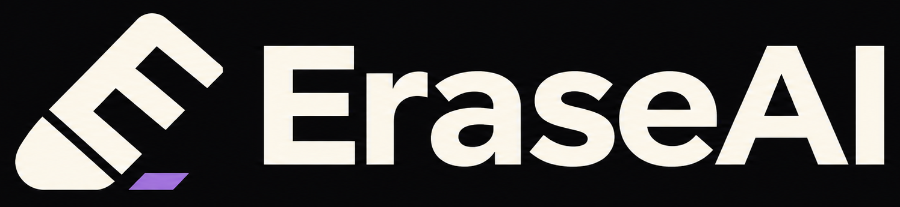
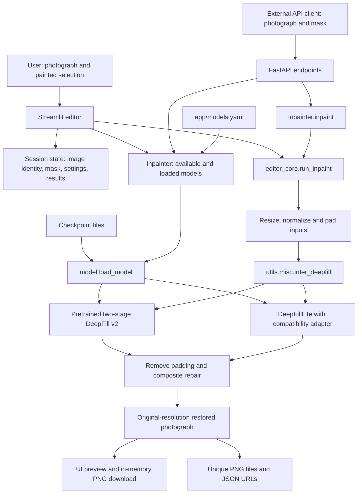
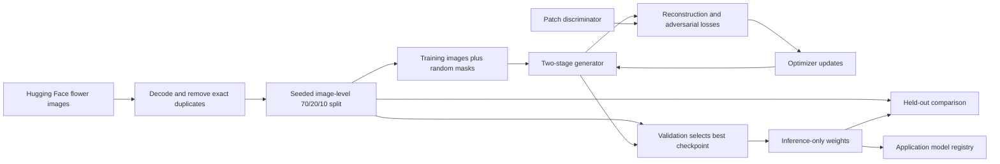
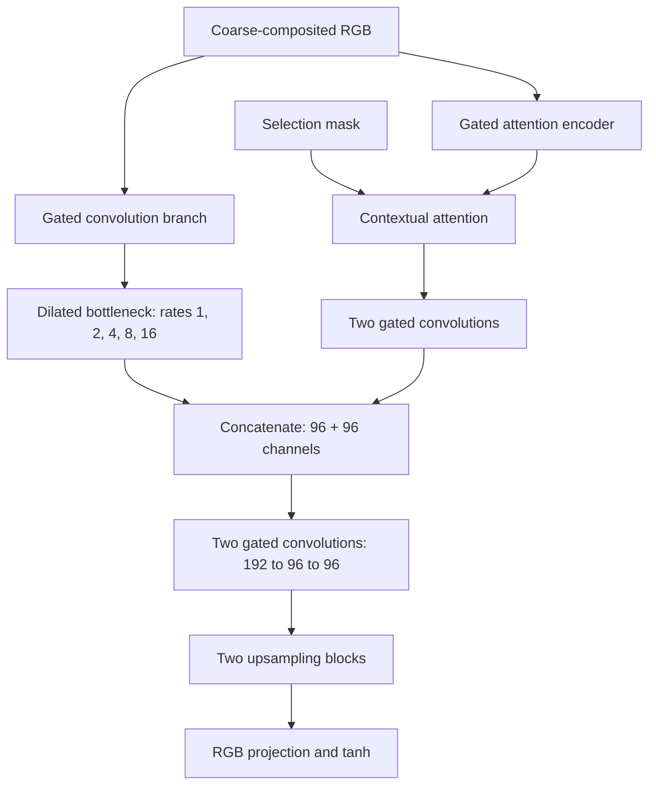

# EraseAI — architecture, operation, and model comparison



EraseAI is an image-inpainting application: a user marks part of a photograph, a neural network reconstructs the selected region, and the application composites that repair into the original image. The project supports a pretrained **DeepFill v2 Places2** checkpoint and **DeepFillLite**, our smaller model trained from random initialization.

The central experimental result is a trade-off: **our lightweight checkpoint is smaller and faster, while the pretrained checkpoint achieved better reconstruction scores on the measured test set.** This README explains the implemented system from input to output, the architecture of both models, how the custom model was trained, and what the comparison establishes. It is not an installation or launch guide.

## Contents

- [What the application does](#what-the-application-does)
- [Complete project architecture](#complete-project-architecture)
- [From photograph to restored PNG](#from-photograph-to-restored-png)
- [How the model registry works](#how-the-model-registry-works)
- [Pretrained DeepFill v2 architecture](#pretrained-deepfill-v2-architecture)
- [Our DeepFillLite architecture](#our-deepfilllite-architecture)
- [Training our model from scratch](#training-our-model-from-scratch)
- [Measured comparison](#measured-comparison)
- [Why a repaired region can still look wrong](#why-a-repaired-region-can-still-look-wrong)
- [Interfaces, state, and storage](#interfaces-state-and-storage)
- [Source-code responsibilities](#source-code-responsibilities)
- [Verification and current limitations](#verification-and-current-limitations)
- [Credits and references](#credits-and-references)

## What the application does

The user supplies an RGB photograph and a selection mask. The mask identifies pixels to reconstruct; it does not describe the real background hidden behind an object. The model estimates plausible content from the remaining context.

The editor provides:

- Image upload and bundled sample photographs.
- Brush and rectangle selection, brush-size adjustment, mask color, clear selection, and mask preview.
- A model dropdown: **DeepFill v2**, **DeepFillLite**, or **Compare both** when both checkpoints are available.
- Adjustable inference size for pretrained DeepFill v2; a fixed 128 px setting for DeepFillLite and comparison.
- Original/restored views for a single model, or side-by-side restored views for both models.
- Coarse-stage previews and downloadable PNG results.
- A measured-comparison panel with the benchmark's scope and limitations.

The restoration model is not trained inside the website. Selecting a model loads existing weights and performs inference. Training remains a separate notebook experiment.

## Complete project architecture



**The UI and API are parallel entry points.** Streamlit invokes Python inference functions in its own process. It does not send an HTTP request to FastAPI. Both interfaces reuse `editor_core.py`, `Inpainter`, and the model implementations, preventing separate preprocessing and output-sizing behavior.

Training has a separate path:



The generator is needed for inference. The training discriminator and optimizers are not shipped as part of the application inference model.

## From photograph to restored PNG

### 1. The source image is opened

The editor accepts PNG, JPEG, BMP, and WebP files. Pillow decodes the image, applies EXIF orientation, and converts it to RGB. Unsupported or unreadable uploads produce feedback rather than proceeding to inference.

The original decoded RGB image remains the source for final compositing. This is the oriented pixel representation, not the original compressed file's bytes or metadata.

Uploaded image bytes are hashed to identify the current source. A bundled sample instead has a sample-specific identity. This keeps results from one photograph from being presented as results for another photograph with a similar filename.

### 2. A display canvas is created

The canvas fits the photograph to the editor's measured available width while preserving its aspect ratio. Its longest edge is capped at 640 display pixels. **Canvas size is independent of inference size and export size.**

A brush or rectangle writes a selection layer over the background photograph. The canvas returns RGBA drawing data; the application reads its alpha channel, not the selected brush color, to determine which locations were painted.

### 3. The drawing becomes a binary mask

`mask_from_canvas()` maps any positive drawing alpha to a white mask pixel. The mask is resized back to the source photograph's dimensions using nearest-neighbor sampling.

| Mask value | Meaning |
|---|---|
| `0` / black | Preserve the source pixel |
| `1` in a tensor, or `255` in an image / white | Reconstruct this location |

The UI counts selected pixels and rejects an empty selection. A mask preview lets the user inspect the actual region being sent to inference.

When the editor is resized, drawing objects are rescaled. The previous full-size mask is temporarily retained until the remounted canvas supplies fresh pixel data. Canvas undo history can reset when remounting occurs.

### 4. The application resolves the chosen model

The dropdown maps to one or two registry keys:

| UI choice | Internal key(s) | Inference size |
|---|---|---|
| DeepFill v2, pretrained Places2 | `pt_places2` | User-selected: 128–768 px from the available presets |
| DeepFillLite, trained from scratch | `deepfill_lite` | 128 px |
| Compare both | `pt_places2`, `deepfill_lite` | 128 px for both |

Both models in comparison receive the same photograph, selection, and resized inputs. The application does not deliberately degrade one output to make the other look better.

The fixed lightweight setting is an application guardrail reflecting its training and evaluation scale. Its convolutional architecture can accept other compatible tensor sizes, but those sizes have not been validated for this checkpoint. The API rejects an incompatible requested size instead of silently changing it.

### 5. Inputs are resized and padded

`prepare_inputs()` validates that image and mask dimensions match and that inference size is positive. It scales the entire photograph so its longest edge matches the selected size, preserving aspect ratio. RGB pixels use bicubic interpolation; mask pixels use nearest-neighbor interpolation.

The image becomes a floating-point tensor with shape `3 × H × W`, initially in `[0, 1]`. The mask becomes `1 × H × W`.

The right and bottom edges are padded to multiples of eight. RGB padding replicates edge pixels; mask padding is zero. The shared low-level inference helper otherwise crops dimensions to multiples of eight, so padding first prevents it from discarding actual image edges.

For example, a `512 × 365` photograph at 128 px inference becomes `128 × 91`, then `128 × 96` after padding. Padding is removed after inference. The final restored photograph is still `512 × 365`.

### 6. The model input is constructed

`infer_deepfill()` converts RGB values to `[-1, 1]`, binarizes the mask, and removes the selected RGB content from the model's input:

```text
I = normalized RGB photograph
M = binary selection, where 1 means missing
masked_rgb = I × (1 − M)
shared_input = concatenate(masked_rgb, ones, M)
```

The shared input has five channels: three RGB channels, a constant-one channel, and the mask channel. A batch dimension is added before the generator runs. Gradients are disabled during inference; no model weights are updated.

Pretrained DeepFill v2 consumes this interface directly. The DeepFillLite adapter extracts the masked RGB channels and the separate mask, then reconstructs the channel ordering used during its training: `[masked_rgb, M, ones]`.

### 7. Coarse prediction is refined

Both generators predict a coarse RGB image and then a refined RGB image. The coarse prediction is inserted into the hole before the refinement stage. The models differ substantially in their stage architectures, especially the pretrained model's contextual-attention branch.

The refined prediction is composited with the known pixels at inference resolution. The helper converts requested outputs into RGB arrays. `stage1` is a raw coarse-stage prediction, not an additional full-resolution polished repair.

### 8. Only the repair is placed into the original photograph

The application removes padding and resizes the inferred repair to the original source dimensions using Lanczos interpolation. It then composites with the original binary mask:

```text
final = resized_repair × original_mask
      + original_RGB × (1 − original_mask)
```

**Every pixel outside the original binary selection remains identical to the decoded, oriented RGB source.** The entire low-resolution inference result is not used as the final photograph. This prevents global blur caused by shrinking a large upload to 128 px and then enlarging the entire result.

This is not super-resolution. Pixels generated inside the selected area still inherit the inference model's detail limitations. A large repaired area can remain soft even though the untouched photograph stays sharp. There is currently no feathering, color matching, or Poisson blending at the repair boundary.

### 9. Results are displayed and exported

A single-model result shows the source and repair. Comparison mode displays both restored photographs alongside each other. Each restored image has its own PNG download; the coarse-stage preview remains at inference resolution.

The UI stores a result signature containing the image identity, mask hash, model keys, inference size, and pipeline version. If any of these change, it hides the stale result and requests another restoration. Changing model choice does not reuse a previous model's output as though it were newly computed.

## How the model registry works

[`app/models.yaml`](app/models.yaml) defines each model's checkpoint path, whether it loads at startup, optional inference-size requirement, and requested outputs.

`Inpainter` includes only entries whose weight files exist. Startup entries load immediately when the manager is created; other models load on first request and remain available for reuse. Streamlit caches the manager, keyed by the configuration file's modification time. The API maintains a process-level manager of its own.

[`model/__init__.py`](model/__init__.py) distinguishes checkpoint formats:

- A legacy DeepFill checkpoint stores generator weights under `G`. State-dictionary keys identify the PyTorch-native versus TensorFlow-converted architecture.
- Our lightweight export declares `DeepFillLite-two-stage-no-contextual-attention` and stores its generator under `state_dict`, with the base-channel count. It loads through `DeepFillLiteGenerator` with strict state-dictionary matching.

Additional registry entries describe converted Places2 and CelebA-HQ checkpoints. They are selectable only if their files are present. They were **not** part of the reported two-model benchmark.

The application automatically selects CUDA when available, otherwise CPU. The separate local training and benchmark used Apple Metal (`mps`). Do not interpret the benchmark's M5 timing as the application's CPU processing time.

## Pretrained DeepFill v2 architecture

The baseline is the project's PyTorch implementation with `cnum=48` and its pretrained Places2 checkpoint. Its generator has **4,052,478 parameters**. That count describes this instantiated implementation; it is not a universal parameter count for all DeepFill v2 reproductions.

DeepFill v2's published method introduced learned gated convolutions and a spectral-normalized patch-based adversarial objective. The implemented refinement network also includes contextual attention. The application uses already-trained weights; it does not reproduce or verify the complete original training run. [Paper: Yu et al., *Free-Form Image Inpainting with Gated Convolution*](https://arxiv.org/abs/1806.03589).

### Gated convolution

Instead of treating every input location as equally trustworthy, a layer learns feature values and gates:

```text
features, gates = split(Conv(input))
output = ELU(features) × sigmoid(gates)
```

A gate can suppress unhelpful features and retain useful context. It is learned from training data; it is not simply a fixed copy of the binary mask. Some attention-branch layers use ReLU, and the final RGB projection is ungated with a tanh output.

### Stage 1: coarse generator

The following describes actual source layers in [`model/networks.py`](model/networks.py). `H` and `W` refer to padded inference dimensions; channel counts below are feature channels **after** gating.

| Component | Operation | Output channels | Spatial size |
|---|---|---:|---|
| Input | Masked RGB + constant channel + mask | 5 | `H × W` |
| Initial layer | Gated 5×5 convolution | 24 | `H × W` |
| Downsampling block 1 | Gated 3×3 stride 2, then stride 1 | 48 | `H/2 × W/2` |
| Downsampling block 2 | Gated 3×3 stride 2, then stride 1 | 96 | `H/4 × W/4` |
| Bottleneck | Seven gated 3×3 layers; dilation rates `1, 2, 4, 8, 16, 1, 1` | 96 | `H/4 × W/4` |
| Upsampling block 1 | Nearest-neighbor ×2, then two gated convolutions | 48 | `H/2 × W/2` |
| Upsampling block 2 | Nearest-neighbor ×2, gated convolution to 24, then to 12 | 12 | `H × W` |
| RGB head | Ungated 3×3 convolution + tanh | 3 | `H × W` |

The coarse image supplies an initial estimate of color and structure inside the hole. Known pixels and this prediction are composited into a three-channel image for stage 2.

### Stage 2: two-branch refinement generator



Both branches work at one-quarter spatial resolution after two downsampling blocks:

- **Convolution branch:** a 5×5 layer produces 24 channels, followed by downsampling to 48 and 96 channels. Five bottleneck layers use dilation rates `1, 2, 4, 8, 16` to gather wider spatial context.
- **Attention branch:** a separate 5×5 layer and downsampling blocks produce 96-channel features. A ReLU-gated layer precedes contextual attention, followed by two gated 96-channel convolutions.
- **Contextual attention:** matches features against usable surrounding patches and uses those relationships to reconstruct missing-region features. It can reuse context; it does not recover a hidden ground-truth background or guarantee correct geometry. The implementation uses 3×3 matching kernels, stride 1, attention rate 2, and softmax scale 10.
- **Merge and decoder:** the two 96-channel outputs concatenate into 192 channels, fuse back to 96, then upsample through 48, 24, and 12-channel operations before the three-channel RGB head.

This branch structure and its learned checkpoint give the pretrained model more capacity and access to explicit contextual matching than our smaller model. Their individual contributions are not isolated by our benchmark.

## Our DeepFillLite architecture

DeepFillLite is an independent, reduced implementation inspired by the two-stage gated-convolution approach. **The architecture is adapted, while the weights are trained from scratch.** It is not a fine-tune of the pretrained checkpoint and is not presented as a new published architecture.

The bundled checkpoint uses **16 base channels**, **779,558 generator parameters**, and two independently parameterized stages. The Python constructor's fallback default is 24 channels, but checkpoint metadata selects 16 when the application loads our trained model.

### Architecture of each stage

Both stages share the same layer pattern, but they do not share weights:

| Layer | Operation | Feature channels | Size for a 128×128 training input |
|---|---|---:|---|
| Input | RGB context + mask + constant-one channel | 5 | 128×128 |
| Encoder 1 | Gated 3×3, stride 1 | 16 | 128×128 |
| Encoder 2 | Gated 3×3, stride 2 | 32 | 64×64 |
| Encoder 3 | Gated 3×3, stride 2 | 64 | 32×32 |
| Bottleneck 1 | Gated 3×3, dilation 1 | 64 | 32×32 |
| Bottleneck 2 | Gated 3×3, dilation 2 | 64 | 32×32 |
| Bottleneck 3 | Gated 3×3, dilation 4 | 64 | 32×32 |
| Bottleneck 4 | Gated 3×3, dilation 8 | 64 | 32×32 |
| Decoder 1 | Nearest-neighbor ×2 + gated 3×3 | 32 | 64×64 |
| Decoder 2 | Nearest-neighbor ×2 + gated 3×3 | 16 | 128×128 |
| Output | Ordinary 3×3 convolution + tanh | 3 | 128×128 |

Each gated convolution internally produces twice the feature-channel count, splitting those values into features and gates.

The two-stage forward pass is:

```text
masked = I × (1 − M)
coarse = Stage1(concatenate(masked, M, ones))
filled = masked + coarse × M
refined = Stage2(concatenate(filled, M, ones))
```

**Differences from the pretrained baseline:** narrower stages, fewer intermediate layers, smaller maximum bottleneck dilation, no contextual-attention branch, and no branch-merging decoder. There are no U-Net skip connections, diffusion steps, or text prompts in this model.

### Training-only discriminator

Our discriminator has **108,273 parameters** and receives four channels: a three-channel completed image plus the binary mask.

| Operation | Output channels | Size at 128×128 input |
|---|---:|---|
| Spectral-normalized 4×4 convolution, stride 2 + LeakyReLU(0.2) | 16 | 64×64 |
| Same pattern | 32 | 32×32 |
| Same pattern | 64 | 16×16 |
| Same pattern | 64 | 8×8 |
| Spectral-normalized 3×3 convolution, stride 1 | 1 | 8×8 score map |

It assigns scores to patches rather than returning one classification label for the whole photograph. It guides training toward plausible local content; it is not used by clients or included in the generator-only inference export.

## Training our model from scratch

### Dataset and split

The actual run used the [`huggan/flowers-102-categories`](https://huggingface.co/datasets/huggan/flowers-102-categories) dataset, pinned to revision `e8e6f53dc08d354a409c003af6e6df5fba2b293c`.

The pool contained 8,189 images. Images were decoded, EXIF-oriented, converted to RGB, and hashed using dimensions plus decoded pixel bytes. Four exact duplicates were removed, leaving 8,185 unique images. The seeded image order was partitioned before masks and augmentation were generated:

| Partition | Images | Purpose |
|---|---:|---|
| Training | 5,729 | Update generator and discriminator weights |
| Validation | 1,637 | Select the best generator checkpoint |
| Test | 819 | Final held-out evaluation and model comparison |

These counts approximate 70/20/10 after integer rounding. This is our new inpainting split of the mirror's image pool, not Oxford's original classification split. Exact deduplication does not detect near-duplicate photographs or related subjects.

### Preprocessing and mask generation

For the completed run, images were resized with aspect ratio preserved. Training used random 128×128 crops and random horizontal flips; validation and test used center crops. RGB values were normalized to `[-1, 1]`.

Training targets were complete photographs. Synthetic irregular brush strokes and occasional rectangles hid parts of those photographs. Masks were constrained to roughly 10–45% coverage, with a central-rectangle fallback if repeated sampling failed. Training masks changed during training; validation and test masks used deterministic seeds tied to source-image rows.

This creates supervised pairs without photographing the same scene before and after physical object removal. It also introduces a limitation: reconstructing synthetic holes in flower photographs is not identical to removing real objects, shadows, and reflections from varied scenes.

### Completed run configuration

| Setting | Actual value |
|---|---|
| Generator initialization | Random; no pretrained generator weights |
| Pretrained feature/perceptual network | None |
| Base channels | 16 |
| Training resolution | 128×128 |
| Batch size | 16 |
| Epochs | 10 |
| Reconstruction-only warmup | First 2 epochs |
| Optimizers | Adam for generator and discriminator |
| Learning rate | `0.0002` for both |
| Adam betas | `(0.5, 0.999)` |
| Adversarial-loss weight | `0.01` |
| Gradient clipping | Norm capped at 5 |
| Local compute | Apple M5, Metal backend; float32, AMP disabled |
| Random seed | 42 |
| Recorded run duration | About 11.25 minutes, including epoch validation and final lightweight evaluation/export |
| Selected checkpoint | Lowest validation masked MAE; epoch 10 in this run |

The larger notebook's suggested defaults are not the completed run configuration. The execution script explicitly selected the smaller 16-channel model and the settings above.

### Losses and parameter updates

Define `region_L1(P, I, R)` as absolute RGB prediction error averaged over pixels selected by region `R`, with channel count included in the denominator.

For each stage:

```text
L_reconstruction = 6 × region_L1(prediction, target, hole)
                 + 1 × region_L1(prediction, target, known_region)
```

The generator receives reconstruction supervision on both its coarse and refined predictions.

After warmup, the discriminator uses hinge loss:

```text
L_D = mean(ReLU(1 − D(real_image, M)))
    + mean(ReLU(1 + D(completed_image.detach(), M)))

L_G = L_reconstruction(coarse) + L_reconstruction(refined)
    − 0.01 × mean(D(completed_image, M))
```

During the discriminator step, the generated photograph is detached so its gradients do not update the generator. During the generator step, discriminator parameters are frozen while gradients still flow through its operations to the generator. The discriminator is in evaluation mode for that step to keep spectral-normalization state fixed.

No discriminator loss is used during the first two warmup epochs. There is no pretrained VGG perceptual loss or feature-matching loss in this experiment. Smaller masks, L1-driven training, limited data, and short training can favor smooth predictions rather than detailed texture.

### Checkpoints and notebook provenance

The training experiment remains outside the application repositories. Its original notebook and execution script produced the completed checkpoint, best/latest training checkpoints, split manifest, validation snapshots, history, and test metrics.

A later `DeepFillLite_Simple.ipynb` follows the requested order—preprocessing, dataset, model, training, evaluation—and uses shorter sequential cells. It starts a separate fresh run, uses center-crop preprocessing, and selects best weights by validation reconstruction loss. **It was smoke-tested, but it did not produce the bundled completed checkpoint.**

The application includes only the exported inference weights and compact provenance/benchmark records:

- [`pretrained/deepfill_lite_weights.pt`](pretrained/deepfill_lite_weights.pt): generator-only export, approximately 3 MiB.
- [`pretrained/deepfill_lite_info.json`](pretrained/deepfill_lite_info.json): architecture, data revision, split counts, training settings, and SHA-256 checksum.
- [`pretrained/comparison_summary.json`](pretrained/comparison_summary.json): comparison protocol and aggregate results.

Full optimizer checkpoints, per-image comparison CSV, split manifests, and training notebooks are separate research artifacts, not files implicitly available in a fresh application checkout.

## Measured comparison

### Protocol

Both generators were evaluated on the same **819 held-out flower images**, with identical deterministic synthetic masks and 128×128 inputs. Each model's output was composited with the same known pixels. The lightweight checkpoint was selected using validation data before test evaluation.

The performance measurement used an Apple M5 through PyTorch Metal, batch size one, three warmup forwards per model, and explicit synchronization around each timed prediction. Reported times exclude image loading and transfers. They do not represent upload-to-download latency, CPU execution, or performance at 512–768 px.

The benchmark measures 128×128 reconstruction, not the later original-resolution application compositing path. Enlarging or compositing the result does not improve the generator's benchmark score.

### Results

| Metric | Pretrained DeepFill v2 Places2 | Our DeepFillLite |
|---|---:|---:|
| Generator parameters | 4,052,478 | **779,558** |
| Masked MAE ↓ | **0.09261** | 0.10488 |
| Masked PSNR ↑ | **17.120 dB** | 16.726 dB |
| Masked SSIM ↑ | **0.54470** | 0.48690 |
| Full-image SSIM ↑ | **0.82617** | 0.79801 |
| Mean forward latency ↓ | 9.835 ms | **3.602 ms** |
| Median forward latency ↓ | 9.728 ms | **3.506 ms** |
| Maximum error outside mask | 0 | 0 |

DeepFillLite has approximately **80.8% fewer generator parameters** and a **2.77× lower median forward latency** under this protocol. The pretrained model has lower reconstruction error and higher PSNR/SSIM. These numbers are specific to this measured run; the checkpoint file size of the pretrained export is not its parameter count because checkpoint containers can include other state.

### What the metrics mean

- **Masked MAE:** average absolute error in the missing region, on RGB values in `[0, 1]`; lower is better. An error of `0.10488` is not “89.5% accuracy.”
- **Masked PSNR:** reconstruction signal-to-error ratio in decibels, calculated per image over the hole and then averaged; higher is better.
- **Masked SSIM:** local structural similarity averaged at window centers inside the hole. This implementation uses an 11×11 **uniform** valid window, not a Gaussian-window library default. Window neighborhoods can include surrounding known pixels.
- **Full-image SSIM:** structural similarity over the valid image area. It can appear favorable because both pipelines copy known pixels exactly.
- **Latency:** synchronized model prediction time under the stated device and resolution, not total application processing time.

Metrics are averaged with equal weighting per photograph. Visual assessment remains necessary: a model can obtain reasonable numerical scores while generating blurry, repeated, or implausible content.

### What can be concluded

The tested pretrained checkpoint reconstructed this test set better than our small scratch-trained checkpoint, while our model substantially reduced parameter count and measured forward time.

**This does not establish that training from scratch is inherently ineffective.** Architecture, dataset domain, model capacity, training duration, and optimization budget all differ. It is a practical comparison of two available checkpoints, not a controlled ablation proving which individual design choice caused the quality difference.

Contextual attention and broader pretrained experience are plausible contributors to the baseline's advantage, but this experiment did not isolate their effects. A stronger experiment would hold data and budget constant while changing one component at a time.

## Why a repaired region can still look wrong

| Symptom | Explanation |
|---|---|
| Entire photograph looks blurred | Previously, a low-resolution inference output was enlarged as the full final photograph. The current pipeline preserves original pixels outside the mask. |
| Only the replacement is soft | The model generated limited-resolution content. Upscaling that patch cannot recover details it never predicted. |
| Visible seam or color mismatch | Hard binary compositing has no feathering or explicit illumination matching. |
| Object edge or shadow remains | The selection did not include all pixels associated with the object. |
| Fabricated texture or wrong structure | Inpainting estimates plausible missing content; it cannot know the original hidden scene. |
| DeepFillLite fails on faces or landscapes | Its short flower-only training run is not a general-purpose photo-restoration training corpus. |
| Larger inference size does not help | Higher resolution costs more compute but does not guarantee better learned behavior or compatible texture. |

The current pipeline resizes the **whole image for inference**. It does not yet crop a high-detail local neighborhood around the selection. A crop-and-context approach is a useful next improvement, especially for a small hole in a large photograph.

## Interfaces, state, and storage

### Streamlit editor

The editor owns upload widgets, selection tools, model choice, inference size, session results, and the result signature. Re-running widget interactions executes the Python page again. A cached `Inpainter` avoids reloading the same networks on every interaction.

UI downloads are encoded from the current PIL result into PNG bytes in memory. The UI path does not write those results into `app/files/`. Model state is reused, but individual users' selection/result state belongs to their Streamlit sessions. There is no saved-project database or automatic edit recovery after a session reset.

### FastAPI interface

| Endpoint | Responsibility |
|---|---|
| `GET /api/models` | Report available model metadata and loaded state |
| `POST /api/inpaint` | Accept image, mask, model keys and inference size; return output names and URLs |
| `/files/...` | Serve the generated PNG files |
| `/docs`, `/redoc` | Describe the API using EraseAI branding |
| `/favicon.svg` | Serve the symbol-only icon |

`POST /api/inpaint` decodes RGB and grayscale inputs, validates model selection through `Inpainter`, and calls the shared pipeline. A synchronous route lets FastAPI execute the blocking inference work off the asynchronous event loop; that does not itself provide a GPU job queue or unlimited parallel capacity.

Invalid input sizes, mismatched dimensions, unavailable models, and supported decoding errors produce validation feedback. DeepFillLite requests require `size=128`; comparison requests list both internal keys.

The API writes output files with a per-request UUID so independent requests do not overwrite fixed filenames. It returns `inpainted` and `stage1` entries under each model's result. Restored outputs preserve source dimensions; coarse outputs remain at inference dimensions.

### Storage and deployment boundaries

- Large upstream `.pth` checkpoints are local/ignored. The custom generator-only `.pt` export is bundled with the model integration.
- API result files remain in `app/files/` until removed; automatic expiry is not implemented. Generated files are ignored by Git.
- There is no authentication, per-user output authorization, durable task queue, rate limiting, or cloud storage layer.
- Local operation processes photographs on the local Python server. If deployed remotely, photographs necessarily travel to that server; the word “local” must not be interpreted as browser-only inference.
- The shared model cache has not been load-tested for simultaneous requests. Deployment needs resource limits, retention rules, and concurrency design appropriate to its users.

## Source-code responsibilities

| File or directory | Responsibility |
|---|---|
| [`streamlit_app.py`](streamlit_app.py) | Editor workflow, mask handling, model dropdown, comparison panel, stale-result checks and downloads |
| [`editor.css`](editor.css) | Shared visual tokens, responsive layout and editor styling |
| [`.streamlit/config.toml`](.streamlit/config.toml) | Streamlit theme and interface configuration |
| [`app.py`](app.py) | HTTP routes, request handling, static output serving and branded API documentation |
| [`app/models.yaml`](app/models.yaml) | Checkpoint registry and model output/size requirements |
| [`utils/app_utils.py`](utils/app_utils.py) | `Inpainter`, model availability/loading and API file-output handling |
| [`editor_core.py`](editor_core.py) | Input sizing, mask conversion, padding, shared inference orchestration, original-resolution compositing and PNG encoding |
| [`utils/misc.py`](utils/misc.py) | Low-level DeepFill tensor input construction, generator execution and output conversion; also retains upstream helpers |
| [`model/__init__.py`](model/__init__.py) | Checkpoint-format detection and generator construction |
| [`model/networks.py`](model/networks.py) | PyTorch-native pretrained DeepFill architecture, contextual attention and related upstream network components |
| [`model/networks_tf.py`](model/networks_tf.py) | Architecture compatible with TensorFlow-converted checkpoints |
| [`model/deepfill_lite.py`](model/deepfill_lite.py) | Our lightweight generator and compatibility adapter |
| [`pretrained/`](pretrained/) | Checkpoints, model provenance and measured comparison summary |
| [`download_files.py`](download_files.py) | Acquisition helper for the upstream pretrained checkpoints |
| [`examples/inpaint/`](examples/inpaint/) | Sample source photographs, masks and a demonstration restoration |
| [`assets/`](assets/) | Approved symbol, full logo, original artwork and brand notes |
| [`test_editor_core.py`](test_editor_core.py) | Geometry, masking, padding and untouched-pixel preservation checks |
| [`test_model_options.py`](test_model_options.py) | Lightweight adapter equivalence, checkpoint loading and size guardrails |
| [`test_api.py`](test_api.py) | Request validation, shared-pipeline use, distinct output names and API documentation checks |

## Verification and current limitations

The current verification includes **14 automated tests**, real inference through both generators, output-download checks, and browser checks of model selection and side-by-side comparison. The original-resolution repair test checks exact equality of every unselected output pixel against a detailed source image.

These checks establish software behavior, not universally good restoration. The project still has:

- A lightweight model trained only on a small flower-domain corpus.
- Low-resolution patch inference and no crop-based high-detail processing.
- Hard mask boundaries without a blending/refinement stage.
- No learned click-to-select object segmentation, zoom/pan editing, mask subtraction brush, or persistent edit history.
- Streamlit reruns rather than a continuous graphics-editor interaction loop.
- One deterministic mask per test image in the reported benchmark, rather than multiple mask seeds and coverage-stratified evaluation.
- Exact deduplication but no near-duplicate/subject-group split or confidence intervals in the benchmark report.
- No current production load, security, or broad accessibility audit.

Useful next experiments are a more diverse training set, longer validation-guided training, a controlled contextual-attention ablation, multiple evaluation mask seeds, and crop-based inference. Each should be evaluated independently rather than assuming that more epochs, more pixels, or a more polished UI will automatically improve repairs.

## Credits and references

- Original DeepFill v2 method: Jiahui Yu, Zhe Lin, Jimei Yang, Xiaohui Shen, Xin Lu and Thomas Huang, [*Free-Form Image Inpainting with Gated Convolution*](https://arxiv.org/abs/1806.03589), ICCV 2019.
- Original application repository and author: [JIGGISTYLE / magic-eraser](https://github.com/JIGGISTYLE/magic-eraser), Jitesh Kumar Sharma. Existing upstream model files and pretrained-weight sources are inherited components, not newly trained original DeepFill weights created by this project.
- Flower dataset: [Hugging Face mirror](https://huggingface.co/datasets/huggan/flowers-102-categories) and [Oxford Flowers-102](https://www.robots.ox.ac.uk/~vgg/data/flowers/102/), Maria-Elena Nilsback and Andrew Zisserman. Consult source terms before redistribution or commercial use; a mirror's availability is not a blanket license grant.
- Custom model provenance: [`deepfill_lite_info.json`](pretrained/deepfill_lite_info.json).
- Numerical comparison evidence and scope: [`comparison_summary.json`](pretrained/comparison_summary.json).

The project contribution includes the EraseAI interface and shared inference workflow, the lightweight architecture adaptation and scratch-trained weights, reproducible evaluation, and integration of both models for inspection. It does not claim authorship of the original DeepFill v2 method or recovery of the true content hidden behind removed objects.
